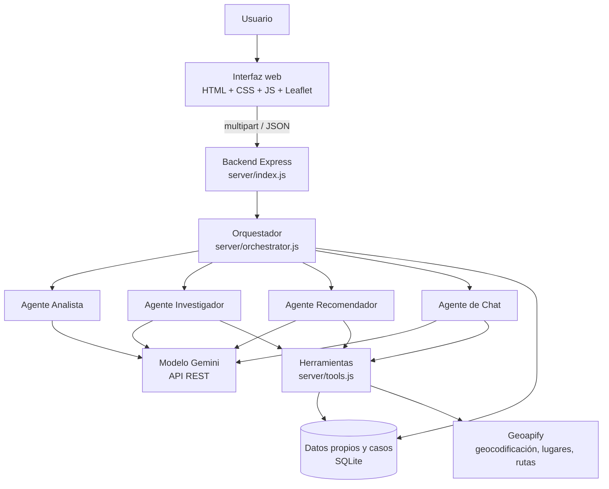

# MovilBogotá · Solución inteligente multimodal de movilidad y servicios urbanos

Aplicación web que ayuda a una persona en Bogotá a resolver una necesidad de movilidad (por ejemplo, "se me pinchó la llanta de la bicicleta", "necesito una farmacia abierta" o "cómo llego a la Universidad Nacional") combinando **análisis multimodal con IA, datos propios, un servicio externo de geolocalización, herramientas, acciones, agentes especializados, chat contextual, persistencia y trazabilidad**.

> Proyecto final · Unidad III. No es un chatbot convencional: el modelo no responde "de memoria", sino que primero consulta herramientas y la aplicación ejecuta acciones que cambian su estado.

---

## 1. Alcance, usuarios y funcionalidades

**Usuarios:** peatones, ciclistas, conductores y usuarios de transporte público en Bogotá que necesitan encontrar un servicio cercano o llegar a un destino, incluidas personas con necesidades de accesibilidad.

**Necesidades que atiende** (tabla `tipos_necesidad`): transporte público, atención médica, farmacia, parqueadero, bicicleta (taller, bicicletero, alquiler), carga eléctrica y ruta a un destino.

**Funcionalidades**

| Funcionalidad | Dónde está |
|---|---|
| Entrada de texto + imagen + origen (escrito o GPS) + modo de transporte | `public/`, `POST /api/casos` |
| Análisis multimodal con respuesta JSON estructurada | `agenteAnalista` en `server/agents.js` |
| Detección de información insuficiente, contradictoria o fuera de alcance | `validarAnalisis` en `server/orchestrator.js` |
| Consulta de datos propios (SQLite) | herramienta `consultar_servicios_propios` |
| Geolocalización real (geocodificación, lugares, rutas) | `server/geo.js` + herramientas |
| Acciones que modifican el sistema | `guardar_recomendacion`, `guardar_ruta_en_caso` |
| Chat contextual por caso | `agenteChat`, `POST /api/casos/:id/chat` |
| Dos o más agentes coordinados | `server/orchestrator.js` |
| Persistencia y trazabilidad | `server/db.js`, pestaña "Cómo se obtuvo" |

---

## 2. Arquitectura implementada



| Componente | Implementación |
|---|---|
| **Interfaz web** | `public/index.html`, `styles.css`, `app.js`. Formulario, mapa Leaflet con teselas de OpenStreetMap, resultado, chat, historial y trazabilidad. |
| **Backend** | Node.js + Express (`server/index.js`). Recibe imágenes con Multer (JPG, PNG o WebP, máx. 4 MB). |
| **Modelo de IA** | Google Gemini mediante su API REST (`server/llm.js`). Modelo configurable con `GEMINI_MODEL`. |
| **Datos propios** | SQLite (`better-sqlite3`). Tablas `servicios` (22 registros de catálogo) y `tipos_necesidad`, creadas y cargadas automáticamente (`server/seed.js`). |
| **Herramientas** | `consultar_servicios_propios`, `buscar_lugares_cercanos`, `geocodificar_destino`, `calcular_ruta`. |
| **Servicio externo** | Geoapify (Geocoding, Places y Routing). |
| **Agentes y coordinación** | 4 agentes + orquestador en código (sección 4). |
| **Acciones** | `guardar_recomendacion` y `guardar_ruta_en_caso`: insertan filas en la tabla `acciones`. |
| **Persistencia y trazabilidad** | Tablas `casos`, `mensajes`, `acciones` y `trazas`. |

La documentación coincide con el código: cada elemento anterior corresponde a un archivo del repositorio.

---

## 3. Modelo de IA y servicio de geolocalización: decisiones

### Modelo: Google Gemini (`gemini-3.5-flash-lite` en la configuración de ejemplo)

| Criterio | Justificación |
|---|---|
| Capacidades | Soporta texto e imagen en la misma petición, llamadas a funciones (herramientas) y salida JSON con esquema. Los tres son necesarios en este proyecto. |
| Multimodalidad | La imagen se envía como `inlineData` junto con el texto al Agente Analista. |
| Latencia y costo | Los modelos de la familia *Flash* están pensados para respuestas rápidas y de bajo costo, adecuados para un flujo con varias llamadas por caso. |
| Disponibilidad y límites | Se obtiene una clave en Google AI Studio sin infraestructura propia. Los límites del nivel gratuito cambian con el tiempo; deben revisarse en la documentación oficial. |
| Función en la solución | Es el modelo de **todos** los agentes, con instrucciones y herramientas distintas. No se combinan modelos porque no hay una razón técnica que lo justifique. |

El modelo se cambia con la variable `GEMINI_MODEL` sin tocar el código. Gemini no permite combinar en una misma llamada herramientas y esquema JSON de salida en todos los modelos, por eso el **análisis estructurado** (sin herramientas) y el **uso de herramientas** están en agentes distintos.

### Geolocalización: Geoapify

| Criterio | Justificación |
|---|---|
| Cobertura funcional | Una sola API cubre geocodificación (`/v1/geocode/search`), lugares por categoría (`/v2/places`) y rutas (`/v1/routing`), que son las tres consultas que necesita el caso. |
| Costo | Según el enunciado de la actividad, el plan gratuito permite 3.000 créditos diarios sin tarjeta; conviene confirmarlo en su sitio antes de la sustentación. |
| Alternativas descartadas | Nominatim público: límites estrictos y sin rutas ni lugares por categoría. OpenRouteService: no ofrece búsqueda de lugares por categoría con la misma facilidad. Requerirían integrar dos servicios. |
| Modos de ruta | `walk`, `bicycle`, `drive` y `transit`. Si `transit` falla, se reintenta con `approximated_transit` y el resultado queda marcado. |

Las categorías de lugares (`public_transport`, `healthcare.hospital`, `healthcare.pharmacy`, `parking`, `rental.bicycle`, `service.vehicle.charging_station`) están en `server/seed.js` y pueden ajustarse según la documentación de Geoapify. Si una categoría fallara, la herramienta devuelve el error al agente y el sistema continúa con datos propios.

---

## 4. Agentes y orquestación

Cada agente es una función distinta con **sus propias instrucciones, entradas, herramientas y salida**. La separación se verifica en la pestaña "Cómo se obtuvo".

| Agente | Responsabilidad | Recibe | Herramientas | Produce |
|---|---|---|---|---|
| **Analista** | Interpretar texto, imagen y ubicación; evaluar si la información alcanza | Texto, imagen, origen, modo | Ninguna (salida con esquema JSON) | Análisis estructurado |
| **Investigador** | Reunir candidatos reales y calcular rutas | Análisis del caso | `consultar_servicios_propios`, `buscar_lugares_cercanos`, `geocodificar_destino`, `calcular_ruta` | Candidatos y resumen de lo no verificado |
| **Recomendador** | Elegir la mejor opción y registrar la decisión | Análisis + candidatos verificados | `guardar_recomendacion` (acción, obligatoria) | Recomendación guardada |
| **Chat** | Responder preguntas de seguimiento del caso | Contexto del caso + historial + pregunta | Las 4 de consulta + `guardar_ruta_en_caso` | Respuesta fundamentada |

**Orquestador (`procesarCaso`)** decide el orden y las condiciones:

1. Registra el caso y ejecuta el **Analista**.
2. **Compuerta de calidad** (reglas en código sobre lo que dijo el modelo). Si el estado no es `suficiente`, el flujo se detiene y se guardan las preguntas aclaratorias.
3. Resuelve el origen: GPS, o geocodificación del texto. Si no se encuentra, pide aclaración.
4. Ejecuta el **Investigador**. Si falla, aplica una búsqueda directa de respaldo.
5. **Condición:** si no hay candidatos, amplía el radio a 6 km una sola vez. Si sigue sin haber, termina con estado `sin_resultados`.
6. Calcula rutas faltantes para los 3 candidatos más cercanos.
7. Ejecuta el **Recomendador**; si no ejecuta la acción, el orquestador guarda una recomendación de respaldo y lo advierte.
8. Persiste el resultado.

### Respuesta estructurada del análisis

`estado_informacion`, `motivo_estado`, `preguntas_aclaratorias[]`, `tipo_necesidad`, `resumen_necesidad`, `urgencia`, `modo_transporte`, `requiere_accesibilidad`, `origen_texto`, `destino_texto`, `restricciones[]`, `hallazgos_imagen {hay_imagen, descripcion, relevante_para_caso, coincide_con_texto}`, `confianza`, `datos_faltantes[]`.

### Información insuficiente, contradictoria o fuera de caso

| Situación | Cómo se detecta | Resultado |
|---|---|---|
| Insuficiente | Sin origen, sin destino en una ruta, o confianza < 0,4 | Estado `requiere_aclaracion` y preguntas al usuario |
| Contradictoria | `hallazgos_imagen.coincide_con_texto = false` o el modelo lo indica | Estado `requiere_aclaracion` |
| No corresponde al caso | `tipo_necesidad = otro` | Estado `fuera_de_alcance` |

### Control de veracidad en el chat

El Agente de Chat recibe solo el contexto del caso y los resultados de herramientas. Sus instrucciones prohíben afirmar horarios, precios, tráfico o disponibilidad que no estén en esos datos, y le exigen llamar a `guardar_ruta_en_caso` antes de decir que guardó algo. Los datos sin verificar aparecen como "No verificado" en la interfaz.

---

## 5. Persistencia y trazabilidad

| Tabla | Contenido |
|---|---|
| `casos` | Texto, imagen, origen, análisis (JSON), estado, resultado (JSON) |
| `acciones` | Tipo, datos y agente que la ejecutó (`recomendacion_guardada`, `ruta_guardada`) |
| `mensajes` | Conversación del chat de cada caso |
| `trazas` | Cada paso: orquestador, agente o herramienta, quién lo invocó, entrada, salida, estado y duración en ms |

Los casos anteriores se recuperan desde el panel lateral o con `GET /api/casos/:id`. La pestaña **Cómo se obtuvo** muestra la secuencia completa de agentes y herramientas.

---

## 6. API

| Método y ruta | Descripción |
|---|---|
| `GET /api/estado` | Indica si las claves están configuradas |
| `POST /api/casos` | Crea y procesa un caso (`multipart/form-data`: `texto`, `imagen`, `origen_texto`, `origen_lat`, `origen_lon`, `modo`) |
| `GET /api/casos` | Lista los casos |
| `GET /api/casos/:id` | Caso, acciones, mensajes y trazas |
| `POST /api/casos/:id/chat` | Pregunta de seguimiento `{ "mensaje": "..." }` |

---

## 7. Instalación y ejecución

**Requisitos:** Node.js 18 o superior, una clave de [Google AI Studio](https://aistudio.google.com/apikey) y una clave de [Geoapify](https://www.geoapify.com/). Se necesita **internet incluso si se ejecuta en localhost**, porque las API externas se consultan en línea.

### Windows (PowerShell)

```powershell
git clone https://github.com/Arnulfo-Monroy/movilbogota-ia.git
cd movilbogota-ia
npm install
Copy-Item env.example .env
# Abra .env y configure GEMINI_API_KEY y GEOAPIFY_API_KEY
npm start
```

Para quien ya tiene el proyecto y su archivo `.env` configurado, **no ejecute de nuevo `Copy-Item` para sustituirlo**. Mantenga la base de datos local en `data/app.db` si desea conservar el historial.

### macOS / Linux

```bash
git clone https://github.com/Arnulfo-Monroy/movilbogota-ia.git
cd movilbogota-ia
npm install
cp env.example .env
# Edite .env y complete GEMINI_API_KEY y GEOAPIFY_API_KEY
npm start
```

Abra **http://localhost:3000**. La base SQLite (`data/app.db`) se crea automáticamente en el primer arranque. Visite **http://localhost:3000/api/estado** para comprobar si las variables de entorno fueron cargadas; esta verificación no prueba por sí sola que las API externas respondan.

**Modelo de IA:** `env.example` incluye `gemini-3.5-flash-lite`, que respondió en las pruebas realizadas para esta entrega. La disponibilidad y las cuotas dependen de cada cuenta y pueden cambiar; si falla, consulte en Google AI Studio los modelos que admiten `generateContent` y ajuste `GEMINI_MODEL` en `.env`.

**Variables de entorno** (en `env.example`, sin credenciales reales):

| Variable | Uso |
|---|---|
| `GEMINI_API_KEY` | Clave privada de Gemini |
| `GEMINI_MODEL` | Modelo de IA (ejemplo: `gemini-3.5-flash-lite`) |
| `GEOAPIFY_API_KEY` | Clave privada de Geoapify |
| `PORT` | Puerto local (3000 por defecto) |
| `DB_PATH` | Ruta de SQLite |

**Privacidad:** nunca publique `.env`, la base de datos con casos reales ni las imágenes subidas. `.gitignore` excluye estos archivos. Si configura nuevos equipos, cada persona debe usar sus propias claves de API.

---

## 8. Demostración y evidencias

Se permite una sustentación **local desde el portátil** (comunicación de la docente del 8 de octubre de 2026). El repositorio contiene el código y no requiere una URL de despliegue. Para la demostración hay que tener conectividad a Gemini y Geoapify.

1. **Caso con resultados reales:** pedir "Necesito encontrar una farmacia cercana al Museo del Oro en Bogotá. Quiero llegar caminando". Origen: "Museo del Oro, Bogotá, Colombia"; modo "a pie". Mostrar geocodificación, candidatos, ruta y acción guardada.
2. **Multimodalidad:** enviar texto sobre una llanta de bicicleta desinflada y adjuntar una fotografía relacionada. Verificar el objeto `hallazgos_imagen` y la traza del Agente Analista. Si el origen escrito no puede ubicarse con confianza suficiente, usar un lugar reconocido o GPS del usuario con permiso.
3. **Información insuficiente:** solicitar una ruta sin destino; el sistema pregunta a dónde se desea llegar.
4. **Contradicción:** describir un carro averiado y adjuntar una fotografía de la rueda de una bicicleta; el sistema debe solicitar aclaración.
5. **Fuera de alcance:** pedir una receta de cocina; la aplicación no debe recomendar lugares.
6. **Chat y acciones:** consultar alternativas y guardar una ruta, mostrando su `accion_id`.
7. **Persistencia:** reiniciar `npm start`, recuperar el caso y consultar "Cómo se obtuvo" para mostrar las herramientas y los agentes involucrados.

Los casos registrados durante el desarrollo no se incluyen en el repositorio porque la base de datos e imágenes locales se excluyen de Git. Las pruebas manuales documentadas están en [`docs/PRUEBAS_MANUALES.md`](docs/PRUEBAS_MANUALES.md).

---

## 9. Limitaciones conocidas

- Los **datos propios** son un catálogo de demostración: los nombres con "(demo)" son ficticios y las coordenadas son aproximadas. Sus horarios son datos de prueba, no horarios verificados. No deben presentarse como establecimientos reales.
- Geoapify Places indica lugares y Geoapify Routing calcula rutas, pero no confirma por sí solo que un negocio esté abierto o preste un servicio concreto. No se consultan tráfico, tarifas ni disponibilidad en tiempo real. Las intersecciones imprecisas pueden requerir aclaración o GPS.
- Las teselas del mapa usan el servidor público de OpenStreetMap, adecuado para desarrollo y demostración; para producción debe usarse un proveedor de teselas propio o contratado.
- Las salidas de un modelo de lenguaje pueden contener errores; por eso la aplicación calcula distancias y rutas con herramientas y muestra la fuente de cada dato.
- No hay autenticación de usuarios; es un prototipo académico.

## 10. Estructura del repositorio

```
├── README.md
├── docs/PRUEBAS_MANUALES.md
├── env.example
├── package.json
├── server/
│   ├── index.js          API REST y archivos estáticos
│   ├── orchestrator.js   Orquestación, validación de calidad y chat
│   ├── agents.js         Los 4 agentes, sus prompts y el esquema de análisis
│   ├── tools.js          Herramientas y acciones
│   ├── llm.js            Cliente de Gemini y bucle de herramientas
│   ├── geo.js            Cliente de Geoapify
│   ├── db.js             SQLite: esquema y acceso a datos
│   └── seed.js           Datos propios iniciales
├── public/               Interfaz web (index.html, styles.css, app.js)
├── data/                 Base de datos (se genera al ejecutar)
└── uploads/              Imágenes subidas por los usuarios
```
